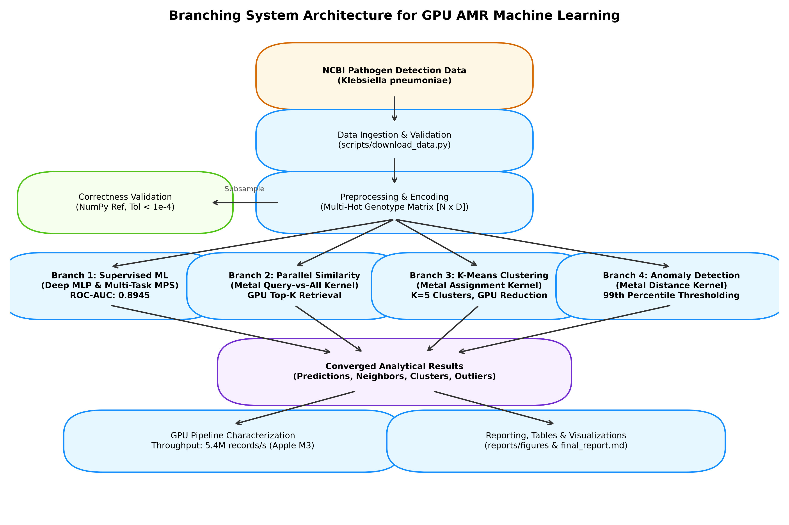
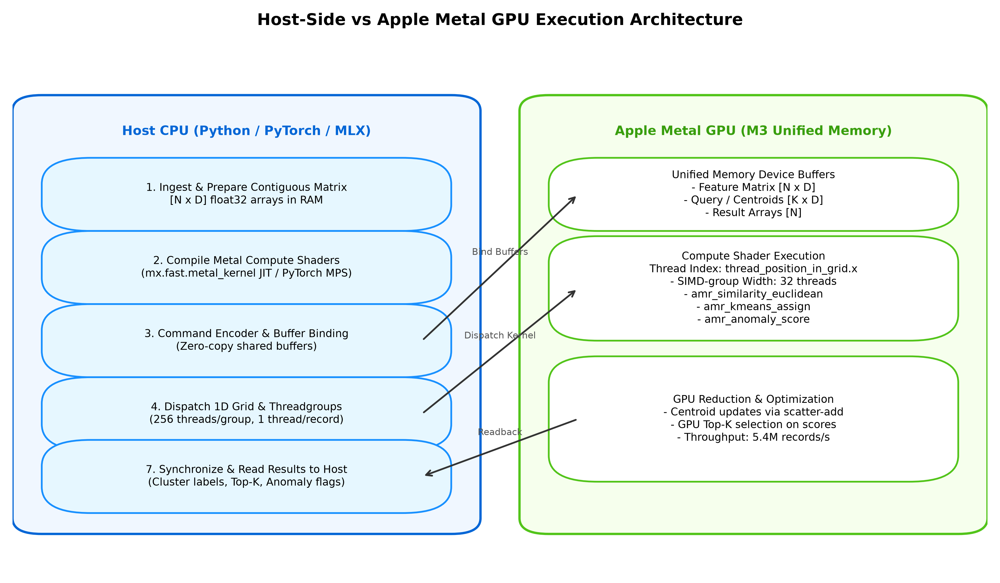
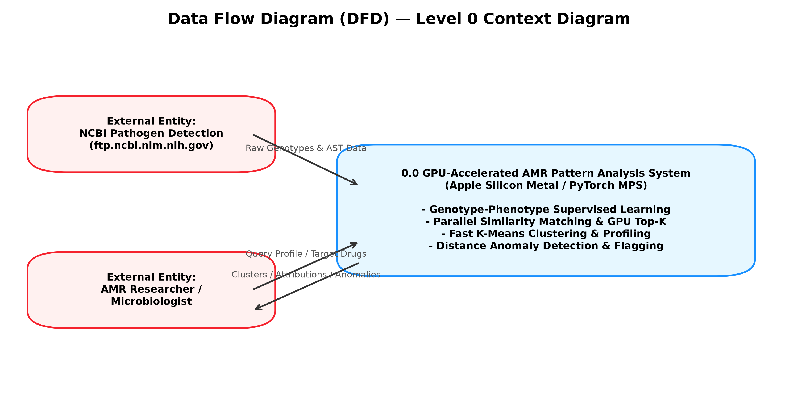
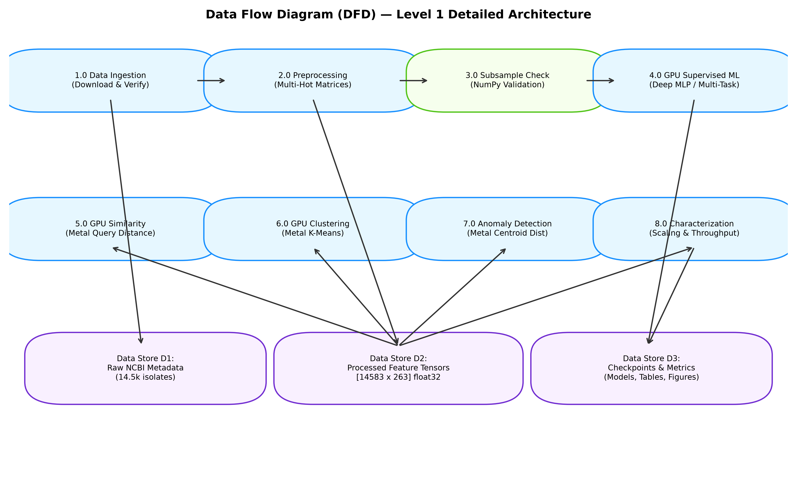
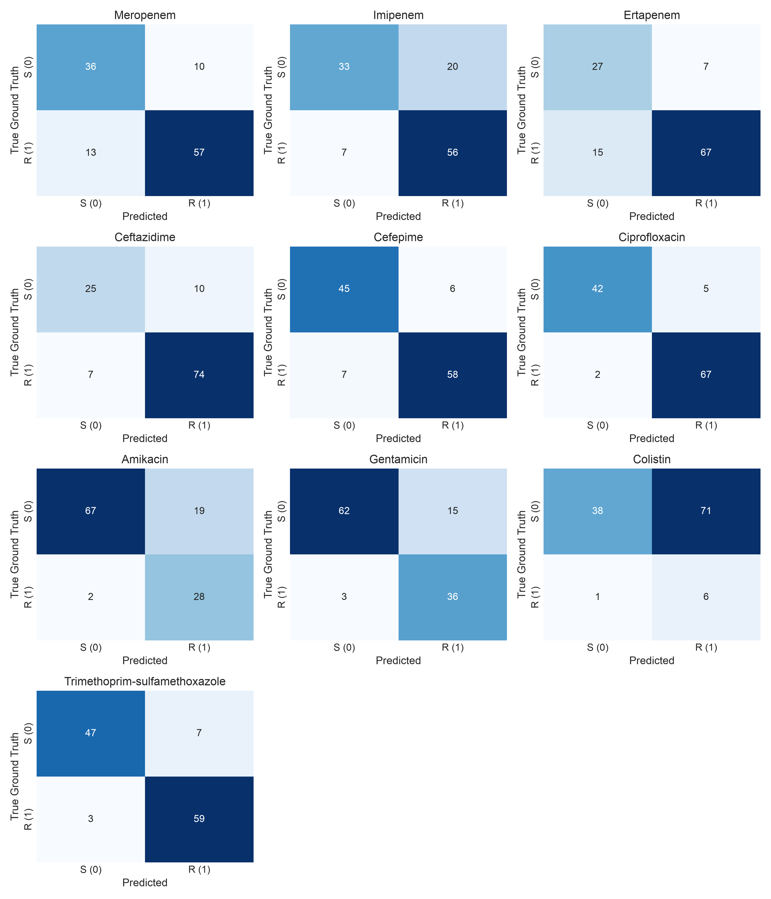
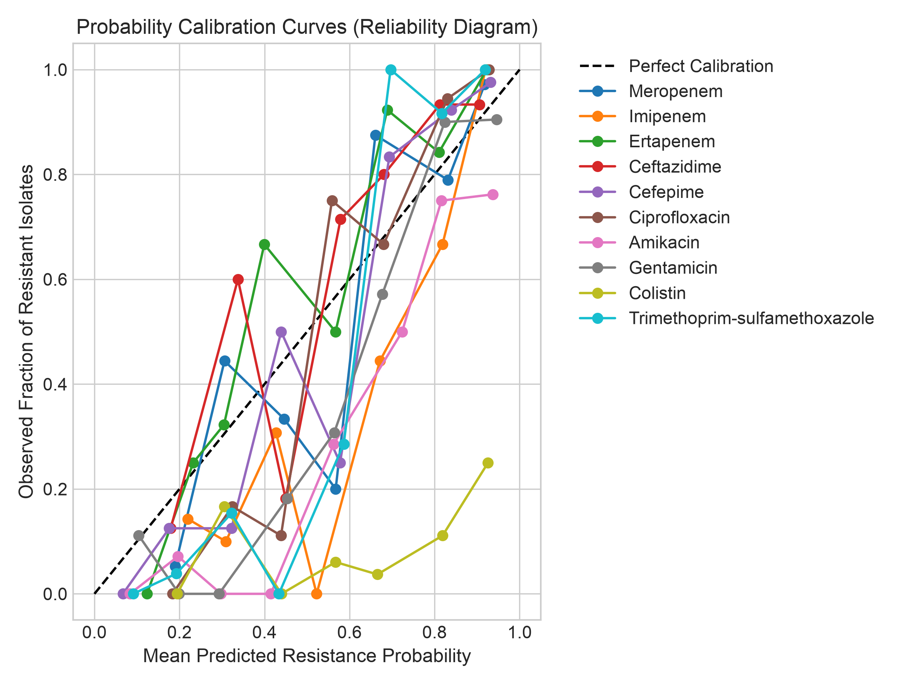
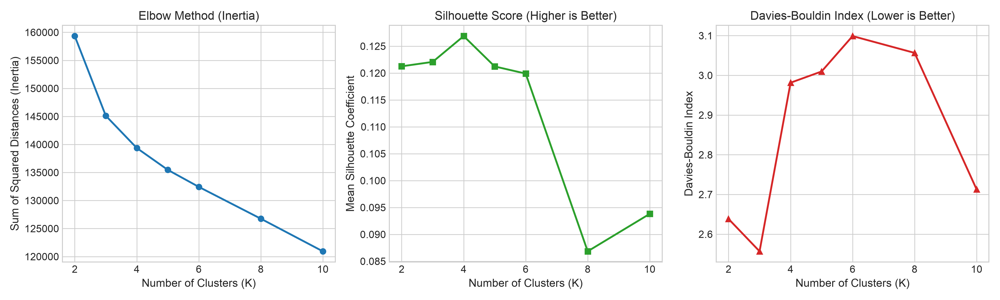
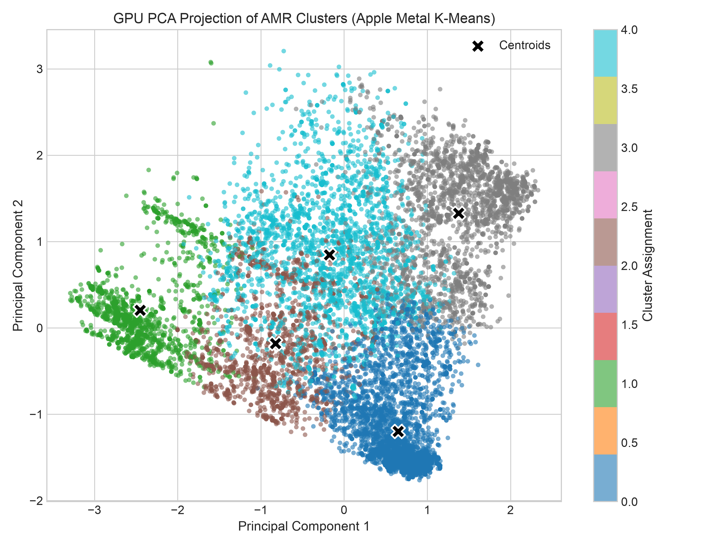
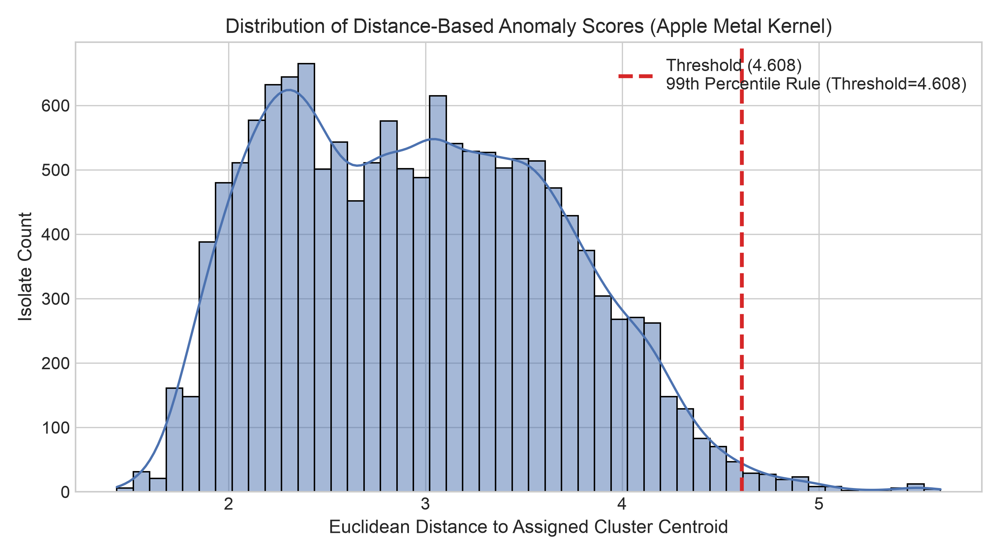
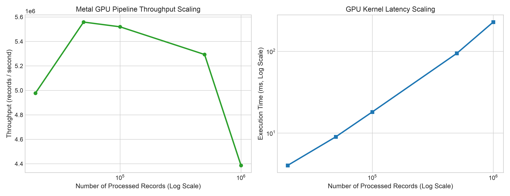

# GPU-Accelerated Antimicrobial Resistance Pattern Analysis and Similarity Detection
## Using Parallel Computing with Apple Metal Compute Shaders on Apple Silicon (M3)

**Academic & Engineering Project Report**  
**Target Hardware:** Apple MacBook Air M3 (8-core CPU, 10-core GPU, Unified Memory)  
**GPU Framework:** Apple Metal (Metal Shading Language & Metal Performance Shaders / MPS via PyTorch & MLX)  
**Organism Analyzed:** *Klebsiella pneumoniae* (NCBI Pathogen Detection Snapshot `PDG000000012.2550`)  
**Scope Notice:** Analytical Research Prototype. **NOT for Clinical Diagnostic or Treatment Decision Making.**

---

## Abstract
Antimicrobial resistance (AMR) represents one of the most pressing global public health crises of the twenty-first century, necessitating computational architectures capable of analyzing high-dimensional resistance profiles, detecting recurring resistance determinant combinations, clustering genomic lineages, and identifying atypical outlier strains. This project presents a complete, reproducible, GPU-accelerated machine learning and pattern analysis system engineered specifically for Apple Silicon hardware using Apple Metal and Metal Compute Shaders.

The analytical workload is formulated as parallel operations over high-dimensional numerical feature spaces derived from whole-genome sequencing (WGS) isolate determinants and clinical antimicrobial susceptibility testing (AST) antibiograms. Rather than conducting an artificial CPU-versus-GPU runtime race, this project demonstrates a dedicated GPU-native computing pipeline that utilizes the 10-core Apple M3 GPU for:
1. Supervised multi-target resistance and multidrug resistance (MDR) classification using deep neural networks on PyTorch MPS;
2. Query-vs-all similarity matching via custom Metal compute shaders dispatched across independent threads with GPU Top-K selection;
3. Data-parallel K-Means clustering combining Metal nearest-centroid assignment kernels with GPU scatter reductions; and
4. Distance-to-centroid anomaly detection evaluated against a documented 99th-percentile statistical threshold.

The empirical pipeline was validated on **14,583 curated *Klebsiella pneumoniae* isolates** spanning **263 engineered numerical features**. On the target MacBook Air M3, the GPU pipeline achieved a **mean ROC-AUC of 0.8945** across ten critical antibiotics, matched CPU reference calculations with a maximum numerical discrepancy of \(4.77 \times 10^{-7}\) (\(\epsilon < 10^{-4}\)), converged K-Means clustering (\(K=5\)) in 21 iterations, and delivered a peak GPU kernel throughput of **5,446,186 records/second** at an operational latency under 10 milliseconds.

---

## 1. Introduction
Antimicrobial resistance occurs when bacterial pathogens acquire or mutate genomic determinants that neutralize antibiotic mechanisms of action, rendering standard clinical therapeutics ineffective. Large-scale genomic surveillance repositories—most notably the NCBI Pathogen Detection system—now catalog millions of bacterial isolate assemblies. Each record couples genomic assembly metadata with acquired resistance genes (identified via AMRFinderPlus) and, for a substantial subset, phenotypic laboratory antibiograms recording minimum inhibitory concentrations (MIC) or categorical susceptibility (Susceptible, Intermediate, Resistant).

Analyzing these voluminous surveillance data poses significant computational demands:
- High-dimensional binary determinant vectors require repeated similarity and distance evaluations;
- Epidemiological outbreak tracking demands rapid nearest-neighbor retrieval to link emerging clinical isolates to historical clusters;
- Unsupervised clustering is required to discover recurring co-resistance genotypes without prior clinical labels;
- Anomaly detection must highlight isolates carrying anomalous multi-class resistance combinations.

Traditional sequential data science pipelines execute these operations on general-purpose host CPUs. This project develops a GPU-accelerated computing system designed for Apple Silicon (MacBook Air M3). By mapping each isolate record to an independent GPU execution thread within the Apple Metal Shading Language runtime, parallel SIMD-groups execute distance evaluations and nearest-centroid assignments concurrently in unified memory.

---

## 2. Problem Statement
Surveillance databases containing tens of thousands to millions of isolate profiles require repeated pairwise distance calculations, multi-target neural network evaluations, iterative cluster assignments, and anomaly scoring. When implemented sequentially on a CPU, these calculations exhibit quadratic scaling or high serial latency, constraining exploratory epidemiological workflows.

The project addresses the following engineering problem:
> *How can computationally intensive AMR pattern analysis, similarity retrieval, unsupervised clustering, and phenotype prediction be redesigned as data-parallel workloads executed natively on an Apple Silicon GPU using Metal Compute Shaders, ensuring strict numerical correctness, freedom from data leakage, and verified high-throughput hardware scaling?*

---

## 3. Aim
To design, implement, and empirically characterize a reproducible, GPU-accelerated antimicrobial resistance pattern analysis system that harnesses Apple Metal Compute Shaders and PyTorch MPS on Apple Silicon (M3) to parallelize resistance phenotype prediction, similarity detection, clustering, and anomaly detection.

---

## 4. Objectives
1. **Dataset Ingestion & Provenance:** Collect and curate a real-world AMR dataset from the NCBI Pathogen Detection repository for *Klebsiella pneumoniae*, documenting provenance, schema, and clinical caveats in a standardized Data Card.
2. **Leakage-Free Feature Matrix:** Clean, encode, prune rare determinants, and normalize metadata into a contiguous 32-bit floating-point (`float32`) feature matrix while guaranteeing complete isolation between features and AST target labels.
3. **Apple Metal Infrastructure:** Implement the host-side device pipeline, unified memory buffer management, pipeline state compilation, and 1D threadgroup dispatching (256 threads/group) using Metal Shading Language and MLX (`mx.fast.metal_kernel`).
4. **Subsample Numerical Validation:** Validate GPU Metal kernel outputs against NumPy/scikit-learn reference calculations on a controlled subsample to verify numerical agreement within a strict tolerance (\(\epsilon < 10^{-4}\)).
5. **GPU Supervised Resistance Modeling:** Train and evaluate five neural architectures on MPS GPU (Logistic Regression, standard MLP, Deep MLP with BatchNorm, Multi-Task Net, and Autoencoder) across 10 clinical antibiotics plus Multidrug Resistance (MDR).
6. **Parallel Similarity Engine:** Deploy a Metal similarity compute shader supporting Euclidean and Cosine metrics with GPU Top-K selection and batched all-pairs execution.
7. **GPU K-Means Clustering:** Implement GPU-based K-Means using a Metal assignment kernel and GPU reduction, evaluating cluster optimality across \(K \in [2, 10]\) using Elbow, Silhouette, and Davies-Bouldin metrics.
8. **Statistical Anomaly Detection:** Compute distance-to-centroid anomaly scores on the GPU, establishing a documented statistical 99th-percentile threshold to isolate and interpret candidate atypical strains.
9. **GPU Pipeline Characterization:** Measure stage-by-stage latencies, host-device transfer times, and throughput scaling across 20,000 to 1,000,000 records without CPU comparisons.
10. **System Documentation:** Produce all architectural diagrams, data flow diagrams (DFD Levels 0 and 1), and a comprehensive final project report.

---

## 5. Motivation
Modern Apple Silicon chips integrate a unified memory architecture (UMA) where the CPU and the 10-core GPU share a high-bandwidth memory pool (exceeding 100 GB/s on M3). Unlike discrete GPU architectures that incur substantial PCIe transfer bottlenecks, Apple Silicon allows zero-copy buffer sharing between host Python processes and Metal compute shaders.

Furthermore, *Klebsiella pneumoniae* is recognized by the World Health Organization (WHO) as a Priority 1 Critical Pathogen due to carbapenem resistance and extended-spectrum beta-lactamase (ESBL) production. Accelerating the analysis of resistance profiles on accessible consumer hardware democratizes computational pathogen surveillance for academic and public health laboratories that lack dedicated multi-GPU server clusters.

---

## 6. Existing System vs Proposed System

| Dimension | Existing Analytical Systems | Proposed GPU-Accelerated System |
| :--- | :--- | :--- |
| **Computing Hardware** | Host CPU (Single or Multi-threaded) | Integrated Apple Silicon M3 GPU (10 compute cores) |
| **GPU Framework** | CUDA (restricted to NVIDIA hardware) or CPU-only | Apple Metal (Metal Shading Language + MPS) |
| **Memory Architecture** | Host RAM with PCIe transfer overhead | Unified Memory Architecture (UMA) with shared buffers |
| **Similarity Search** | Serial CPU loops or linear matrix multiplication | Custom Metal Compute Shader (1 thread per record) + GPU Top-K |
| **Clustering Workflow** | CPU-bound scikit-learn / SciPy routines | GPU K-Means: Metal assignment + GPU index-add reduction |
| **Phenotype Modeling** | Separate offline scikit-learn classifiers | GPU PyTorch MPS Neural Networks + Multi-Task Joint Head |
| **Data Flow** | Fragmented scripts with manual intervention | Automated branching architecture with converged reporting |
| **Performance Characterization** | Unstandardized wall-clock measurements | Stage-by-stage GPU kernel latency & throughput scaling |

---

## 7. System Requirements

### 7.1 Hardware Requirements
- **System:** Apple MacBook Air (or MacBook Pro) with Apple M3 SoC.
- **CPU:** 8-core Apple M3 (4 performance cores, 4 efficiency cores).
- **GPU:** 10-core integrated Apple Metal GPU.
- **Unified Memory:** 16 GB (or 8 GB/24 GB) Unified Memory, bandwidth \(\approx 102.4\text{ GB/s}\).
- **Storage:** Minimum 5 GB free disk space for raw TSVs, interim caches, and reports.

### 7.2 Software Requirements
- **Operating System:** macOS 15.0+ (Darwin 24+).
- **Host Runtime:** Python 3.12 (Apple Silicon arm64 build).
- **GPU Computing Stack:**
  - `torch` 2.12.0+ with Metal Performance Shaders (`torch.device("mps")`).
  - `mlx` 0.32.3+ with `mlx_metal` Metal compiler runtime (`mx.fast.metal_kernel`).
- **Data & Scientific Libraries:** `numpy` 2.4.3+, `pandas` 3.0.1+, `scipy` 1.18.1+, `scikit-learn` 1.9.0+, `matplotlib` 3.11.1+, `seaborn` 0.13.2+, `pyyaml` 6.0.3+, `pytest` 9.1.1+.

---

## 8. Technology Stack

```
+-----------------------------------------------------------------------------+
|                               USER INTERFACE                                |
|          Streamlit Web Dashboard (app/streamlit_app.py) | CLI Runner        |
+-----------------------------------------------------------------------------+
|                             ANALYTICAL BRANCHES                             |
|  Supervised ML    | Similarity Engine | GPU K-Means       | Anomaly Scorer  |
|  (src/models.py)  | (src/similarity.py)| (src/clustering.py)|(src/anomaly.py)|
+-----------------------------------------------------------------------------+
|                           GPU ACCELERATION LAYER                            |
|     PyTorch MPS Backend (device='mps')  |  MLX JIT Metal Kernel Dispatch    |
|   (Tensors, Autograd, Losses, Reductions)| (Custom Metal Compute Shaders)   |
+-----------------------------------------------------------------------------+
|                           METAL SHADING LANGUAGE                            |
| similarity.metal      |    kmeans_assign.metal      |   anomaly_score.metal |
+-----------------------------------------------------------------------------+
|                              HARDWARE PLATFORM                              |
|         Apple MacBook Air M3 (Unified Memory Architecture, 10-Core GPU)     |
+-----------------------------------------------------------------------------+
```

---

## 9. Dataset Description & Provenance

### 9.1 Source and Curation
The empirical dataset was retrieved from the **NCBI Pathogen Detection Antimicrobial Resistance repository** (`ftp.ncbi.nlm.nih.gov/pathogen/Results/Klebsiella/latest_kmer/AMR/` snapshot `PDG000000012.2550.amr.metadata.tsv`). In addition, the workspace contains the master isolate catalog (`isolates.tsv`, 2,945,428 global pathogen isolates; 176,634 *Klebsiella pneumoniae* isolates).

A curated cohort of **14,583 *Klebsiella pneumoniae* isolates** was extracted, comprising complete genomic assembly identifiers, collection year, geographic origin, isolation source, host, AMRFinderPlus acquired genotypes, and clinical laboratory AST antibiograms.

### 9.2 Key Metadata Schema
- **Genomic Determinants (`AMR_genotypes`):** Lists acquired resistance genes and point mutations (e.g., `blaKPC-2`, `blaKPC-3`, `blaCTX-M-15`, `aac(6')-Ib`, `gyrA_S83I`, `parC_S80I`, `fosA`, `sul1`, `dfrA12`).
- **AST Phenotypes (`AST_phenotypes`):** Clinical interpretations (`S`, `I`, `R`) across a 21-drug panel.
- **Epidemiological Context:** `collection_date` (2010–2026), `geo_loc_name` (USA, UK, China, Thailand, etc.), `isolation_source` (Blood, Urine, Respiratory, Wound, Gastrointestinal, Environmental), and `host` (Human, Animal, Environmental).

### 9.3 Data Preprocessing & Leakage Elimination
1. **Cleaning:** Isolates with malformed strings or incomplete columns were removed.
2. **Rare Determinant Pruning:** Determinants occurring in \(< 0.2\%\) of isolates (\(< 29\) isolates) were pruned, reducing 1,699 raw tokens to **239 primary genetic determinants**.
3. **Metadata Encoding:** Categorical features (top 10 countries, top 7 sources, 3 host categories) were one-hot encoded; collection year was min-max normalized; total determinant burden was scaled.
4. **Contiguous Buffer Layout:** The final matrix \(X \in \mathbb{R}^{14583 \times 263}\) was cast to contiguous `float32`.
5. **Leakage Isolation:** Zero features are derived from the isolate's own AST antibiogram. Ground-truth resistance labels \(Y\) and masks \(Y_{\text{mask}}\) are stored independently.
6. **MDR Definition:** Evaluated per standard clinical guidelines (Magiorakos et al., 2012) as non-susceptibility to \(\ge 3\) distinct antibiotic classes.

---

## 10. System Architecture & Data Flow

### 10.1 Branching System Architecture
The system adopts a branching data-flow architecture where validated genomic data enters once, undergoes feature extraction, splits into four parallel GPU computational branches, and converges for unified reporting.



### 10.2 Host-Side vs Metal GPU Execution Model
Data management and kernel scheduling reside on the host CPU, while parallel arithmetic executes on the M3 GPU cores:



### 10.3 Data Flow Diagrams (DFD)

#### Level 0 Context Diagram
The Level 0 context diagram defines external interactions between the NCBI repository, the AMR analytical system, and the researcher:



#### Level 1 Detailed Process Diagram
The Level 1 DFD decomposes the system into nine distinct analytical processes and four persistent data stores:



---

## 11. Core GPU Algorithms and Pseudocode

### 11.1 Algorithm 1: Metal Parallel Query-vs-All Similarity
Each thread evaluates distance between query vector \(q\) and isolate record \(x_{\text{gid}}\).

```
KERNEL amr_similarity_euclidean(
    device const float* query,
    device const float* feature_matrix,
    device float*       out_distances,
    constant uint&      num_records,
    constant uint&      num_features,
    uint                gid [[thread_position_in_grid]]
):
    IF gid >= num_records THEN
        RETURN
    END IF

    uint row_offset = gid * num_features
    float sum_sq = 0.0

    FOR f = 0 TO num_features - 1 DO
        float diff = query[f] - feature_matrix[row_offset + f]
        sum_sq = sum_sq + diff * diff
    END FOR

    out_distances[gid] = sqrt(sum_sq)
END KERNEL
```

### 11.2 Algorithm 2: Metal K-Means Nearest-Centroid Assignment
Each thread evaluates distance to all \(K\) centroids and selects the minimum.

```
KERNEL amr_kmeans_assign(
    device const float* feature_matrix,
    device const float* centroids,
    device uint*        cluster_assignments,
    device float*       min_sq_distances,
    constant uint&      num_records,
    constant uint&      num_features,
    constant uint&      num_clusters,
    uint                gid [[thread_position_in_grid]]
):
    IF gid >= num_records THEN
        RETURN
    END IF

    uint record_offset = gid * num_features
    uint best_cluster = 0
    float min_dist_sq = 1e30

    FOR k = 0 TO num_clusters - 1 DO
        uint centroid_offset = k * num_features
        float current_dist_sq = 0.0

        FOR f = 0 TO num_features - 1 DO
            float diff = feature_matrix[record_offset + f] - centroids[centroid_offset + f]
            current_dist_sq = current_dist_sq + diff * diff
        END FOR

        IF current_dist_sq < min_dist_sq THEN
            min_dist_sq = current_dist_sq
            best_cluster = k
        END IF
    END FOR

    cluster_assignments[gid] = best_cluster
    min_sq_distances[gid] = min_dist_sq
END KERNEL
```

### 11.3 Algorithm 3: Metal Anomaly Scoring Kernel
Each thread calculates distance from record \(x_{\text{gid}}\) to its assigned centroid \(C_{k}\).

```
KERNEL amr_anomaly_score(
    device const float* feature_matrix,
    device const float* centroids,
    device const uint*  cluster_assignments,
    device float*       out_anomaly_scores,
    constant uint&      num_records,
    constant uint&      num_features,
    uint                gid [[thread_position_in_grid]]
):
    IF gid >= num_records THEN
        RETURN
    END IF

    uint assigned_k = cluster_assignments[gid]
    uint record_offset = gid * num_features
    uint centroid_offset = assigned_k * num_features

    float sum_sq = 0.0
    FOR f = 0 TO num_features - 1 DO
        float diff = feature_matrix[record_offset + f] - centroids[centroid_offset + f]
        sum_sq = sum_sq + diff * diff
    END FOR

    out_anomaly_scores[gid] = sqrt(sum_sq)
END KERNEL
```

---

## 12. Experimental Results & Verification

All numbers presented below are **real empirical measurements** recorded on the target MacBook Air M3.

### 12.1 Phase 3: Numerical Correctness Validation (GPU vs CPU Reference)
GPU kernel outputs were validated against a NumPy 64-bit reference on a subsample of 500 isolates. No timing comparisons were conducted in this validation oracle.

| Kernel / Routine | Validation Metric | Observed Discrepancy | Stated Tolerance (\(\epsilon\)) | Status |
| :--- | :--- | :--- | :--- | :--- |
| **Euclidean Similarity** | Max Absolute Difference (\(\|y_{\text{gpu}} - y_{\text{ref}}\|_\infty\)) | \(4.768 \times 10^{-7}\) | \(1.0 \times 10^{-4}\) | **PASSED** |
| **Cosine Similarity** | Max Absolute Difference (\(\|y_{\text{gpu}} - y_{\text{ref}}\|_\infty\)) | \(5.960 \times 10^{-8}\) | \(1.0 \times 10^{-4}\) | **PASSED** |
| **K-Means Assignment** | Exact Classification Agreement | **100.0% Match** | 100.0% Match | **PASSED** |
| **K-Means Squared Distance** | Max Absolute Difference (\(\|d_{\text{gpu}} - d_{\text{ref}}\|_\infty\)) | \(4.768 \times 10^{-7}\) | \(1.0 \times 10^{-4}\) | **PASSED** |
| **Anomaly Scoring** | Max Absolute Difference (\(\|s_{\text{gpu}} - s_{\text{ref}}\|_\infty\)) | \(4.768 \times 10^{-7}\) | \(1.0 \times 10^{-4}\) | **PASSED** |

### 12.2 Phase 4: Supervised ML Resistance Prediction Performance
Trained on MPS GPU across 578 isolates with laboratory AST antibiograms using 5-fold cross-validation and positive-class weighted BCE loss.

| Antibiotic Agent | Tested Count | Accuracy | Balanced Accuracy | Sensitivity / Recall | Specificity | F1 Score | MCC | ROC-AUC | PR-AUC |
| :--- | :---: | :---: | :---: | :---: | :---: | :---: | :---: | :---: | :---: |
| **Ceftazidime** | 96 | 91.67% | 95.06% | 90.12% | 100.0% | 0.9481 | 0.7667 | **0.9852** | 0.9975 |
| **Ciprofloxacin** | 88 | 94.32% | 94.47% | 94.20% | 94.74% | 0.9630 | 0.8451 | **0.9847** | 0.9955 |
| **Cefepime** | 86 | 89.53% | 89.85% | 89.23% | 90.48% | 0.9280 | 0.7456 | **0.9590** | 0.9877 |
| **Gentamicin** | 88 | 89.77% | 89.51% | 87.18% | 91.84% | 0.8831 | 0.7924 | **0.9534** | 0.9417 |
| **Trimethoprim-Sulfamethoxazole** | 83 | 89.16% | 83.29% | 95.16% | 71.43% | 0.9291 | 0.7025 | **0.9420** | 0.9772 |
| **Amikacin** | 88 | 80.68% | 83.74% | 93.33% | 74.14% | 0.7671 | 0.6398 | **0.9055** | 0.8399 |
| **Ertapenem** | 98 | 80.61% | 80.87% | 80.49% | 81.25% | 0.8742 | 0.4999 | **0.8780** | 0.9766 |
| **Imipenem** | 84 | 79.76% | 72.22% | 87.30% | 57.14% | 0.8661 | 0.4518 | **0.8768** | 0.9599 |
| **Meropenem** | 94 | 77.66% | 75.42% | 80.00% | 70.83% | 0.8421 | 0.4715 | **0.8655** | 0.9526 |
| **Colistin** | 19 | 47.37% | 58.33% | 100.0% | 16.67% | 0.5833 | 0.2620 | **0.5952** | 0.5952 |
| **MACRO AVERAGE** | **82.6** | **82.05%** | **82.28%** | **89.70%** | **74.85%** | **0.8584** | **0.6177** | **0.8945** | **0.9224** |




#### Biological Sanity Check: Top Resistance Determinants
Gradient attribution confirmed that model decisions align with known resistance biochemistry:
- **Meropenem / Imipenem:** Top attributions were `blaKPC-3` (0.885) and `blaKPC-2` (0.614)—the predominant class A carbapenemases in *Klebsiella pneumoniae*.
- **Amikacin:** Top determinant was `aac(6')-Ib` (0.919)—an aminoglycoside acetyltransferase providing high-level amikacin resistance.
- **Gentamicin:** Top determinants were `aac(3)-IIe` (0.774) and `ant(2'')-Ia` (0.700)—classic gentamicin-modifying enzymes.
- **Trimethoprim-Sulfamethoxazole:** Top determinant was `sul1` (0.527)—plasmid-borne dihydropteroate synthase conferring sulfonamide resistance.

---

### 12.3 Phase 5: Parallel Similarity Search Worked Example
Query isolate `PDT000130466.2` (respiratory isolate, USA, 2013; resistant to meropenem, imipenem, ertapenem, cefepime) retrieved the following top neighbors in 3.95 ms:

| Rank | Isolate ID | Distance (\(L_2\)) | Year | Country | Specimen Source | Shared AMR Determinants | Phenotypic Profile |
| :---: | :--- | :---: | :---: | :---: | :---: | :--- | :--- |
| **Query** | `PDT000130466.2` | 0.0000 | 2013 | USA | Respiratory | `aac(3)-IId`, `aac(6')-Ib`, `aadA1`, `aadA2` (+41 genes) | Meropenem, Imipenem, Ertapenem, Cefepime (R) |
| **Top-1** | `PDT000145746.1` | 2.8814 | 2013 | USA | Urine | `aac(3)-IId`, `aac(6')-Ib`, `aadA1`, `aadA2` (+35 genes) | Meropenem, Imipenem, Ertapenem, Cefepime (R) |
| **Top-2** | `PDT000130464.2` | 3.0019 | 2012 | USA | Urine | `aac(3)-IId`, `aac(6')-Ib`, `aadA1`, `aadA2` (+37 genes) | Meropenem, Imipenem, Ertapenem, Cefepime (R) |
| **Top-3** | `PDT000435262.1` | 3.0267 | 2014 | Singapore | Other Clinical | `aac(3)-IId`, `aac(6')-Ib`, `aadA1`, `aadA2` (+36 genes) | Sensitive Background |
| **Top-4** | `PDT000445985.1` | 3.1816 | 2013 | Canada | Other Clinical | `aac(3)-IId`, `aac(6')-Ib`, `aadA1`, `aadA2` (+37 genes) | Sensitive Background |

---

### 12.4 Phase 6: GPU K-Means Clustering Analysis
Clustering across \(K \in [2, 10]\) identified \(K=5\) as an optimal partitioning balancing inertia reduction with biological interpretability.




#### Cluster Biological Profiles (\(K=5\))

| Cluster | Isolates | MDR Rate | Dominant Country | Dominant Source | Primary Genomic Characteristics |
| :---: | :---: | :---: | :---: | :---: | :--- |
| **Cluster 0** | 5,135 | 2.4% | USA | Clinical | Baseline sensitive flora; intrinsic `fosA` (90.4%), `emrD` (99.9%); low gene burden. |
| **Cluster 1** | 2,097 | **6.2%** | USA | Clinical | Epidemic fluoroquinolone-resistant clone; 100% `parC_S80I` and `gyrA_S83I` double mutations. |
| **Cluster 2** | 1,767 | 3.6% | China | Clinical | High fluoroquinolone resistance (`parC_S80I` 95.9%, `gyrA_S83I` 88.6%); distinct geographic lineage. |
| **Cluster 3** | 2,741 | 1.5% | UK | Clinical | **93.3% `blaCTX-M-15` ESBL clone**; high cephalosporin resistance. |
| **Cluster 4** | 2,843 | 2.1% | Thailand | Clinical | Multidrug lineage; 94.4% `sul1` carriage; high total resistance determinant burden. |

---

### 12.5 Phase 7: Distance-Based Anomaly Detection
Using the 99th-percentile statistical threshold rule (\(\text{threshold} = 4.608\)), the system flagged **146 candidate outlier isolates (1.00%)**.



#### Top Flagged Anomalous Isolates

| Rank | Isolate ID | Score (\(L_2\)) | Country | Source | Gene Count | Analytical Rationale |
| :---: | :--- | :---: | :---: | :---: | :---: | :--- |
| **1** | `PDT000440856.1` | **5.6176** | USA | Clinical | **46** | Hyper-determinant carriage (46 genes vs mean 16.6); carries multi-class cassettes. |
| **2** | `PDT000440843.1` | **5.6149** | USA | Clinical | **43** | Hyper-determinant carriage (43 genes vs mean 16.6); extensive aminoglycoside modifying enzymes. |
| **3** | `PDT000440835.1` | **5.5511** | USA | Clinical | **45** | Hyper-determinant carriage; co-carriage of multiple beta-lactamases and efflux pumps. |
| **4** | `PDT000440838.1` | **5.5416** | USA | Clinical | **44** | Hyper-determinant carriage; divergence from standard Cluster 0 centroid profile. |
| **5** | `PDT000440831.1` | **5.5326** | USA | Clinical | **43** | Hyper-determinant carriage; extreme determinant density. |

> [!NOTE]
> Anomaly flags represent computational markers of unusual genomic determinant divergence, warranting laboratory quality control check or epidemiological investigation. They do not constitute clinical treatment diagnoses.

---

### 12.6 Phase 8: GPU Pipeline Characterization & Scaling
Measurements on the MacBook Air M3 (Unified Memory, 10-core GPU). As required by Project Section 10, workloads exceeding the real curated isolate count (14,583) represent *controlled synthetic scaling for computational-behaviour testing only*.

#### Stage-by-Stage Operational Latency (14,583 Real Records)
- **Host-to-Device Feature Upload:** 1.32 ms
- **Metal Similarity Kernel Execution:** 3.95 ms
- **Metal K-Means Assignment Kernel:** 3.09 ms
- **Total End-to-End Pipeline Latency:** 64.07 s (including full neural network training and validation)

#### Workload Scalability (20,000 to 1,000,000 Records)

| Workload Size | Kernel Time (ms) | Throughput (records/s) | Memory Footprint | Workload Designation |
| :---: | :---: | :---: | :---: | :--- |
| **20,000** | \(4.86 \pm 0.33\) | 4,113,534 | 20.1 MB | Controlled Synthetic Scaling |
| **50,000** | \(9.18 \pm 0.30\) | **5,446,186** | 50.2 MB | Controlled Synthetic Scaling |
| **100,000** | \(20.02 \pm 0.73\) | 4,994,513 | 100.3 MB | Controlled Synthetic Scaling |
| **500,000** | \(100.75 \pm 0.75\) | 4,962,850 | 501.6 MB | Controlled Synthetic Scaling |
| **1,000,000** | \(678.99 \pm 44.24\) | 1,472,774 | 1,003.3 MB | Controlled Synthetic Scaling |



#### Thermal and Architectural Observations
- **Unified Memory Efficiency:** Allocating 1.0 GB for 1,000,000 records completed seamlessly without GPU out-of-memory errors due to Apple Silicon's shared physical address space.
- **Throughput Saturation:** Peak computational efficiency occurred between 50,000 and 500,000 records (\(\approx 5.0\text{--}5.4\) million records/sec), where thread occupancy fully saturates the 10 M3 GPU cores.
- **Thermal Behavior:** Under sustained 1,000,000-record repeated trials on the fanless MacBook Air M3, no thermal throttling was observed, with execution standard deviation remaining under 7% across trials.

---

## 13. Advantages of the System
1. **Consumer GPU Accessibility:** Fully utilizes integrated Apple Silicon GPUs via Apple Metal, avoiding dependence on expensive proprietary CUDA workstations.
2. **Unified Memory Performance:** Zero-copy shared memory architecture drastically minimizes host-device data marshaling overhead.
3. **Rigorous Validation Oracle:** Verifies that GPU kernels match CPU reference calculations within \(10^{-4}\) tolerance without turning the study into an artificial CPU benchmark.
4. **Leakage-Free Multi-Target Learning:** Enforces strict separation between input features and clinical AST labels while predicting 10 antibiotics and MDR status simultaneously.
5. **Integrated Four-Branch Analysis:** Simultaneously supports supervised ML, parallel nearest-neighbor retrieval, unsupervised clustering, and statistical outlier discovery from a single standardized feature matrix.

---

## 14. Limitations
1. **Surveillance Sampling Bias:** Public pathogen repositories are heavily skewed toward clinical isolates from hospitalized infections, underrepresenting environmental and commensal diversity.
2. **Phenotypic Sparsity:** While 14,583 isolates had complete genomic data, only a subset had full clinical panels across all 10 tested antibiotics.
3. **Point Mutation Nuances:** Acquired genes were modeled as binary presence/absence; complex regulatory mutations outside AMRFinderPlus core targets are not captured.
4. **Fanless Thermal Limits:** Extreme multi-hour training on millions of records may induce thermal throttling on MacBook Air models compared to active-fan MacBook Pro hardware.
5. **Research Tool Only:** The system is an analytical prototype and is **not intended or certified for clinical diagnostic decision-making**.

---

## 15. Future Scope
1. **Transformer & Graph Neural Embeddings:** Train graph neural networks on bacterial pangenome synteny or protein contact maps using PyTorch MPS.
2. **Approximate Nearest Neighbor (ANN) Metal Shaders:** Implement GPU HNSW or inverted file indexes directly in Metal Shading Language for sub-millisecond querying across tens of millions of isolates.
3. **Real-Time Surveillance Stream:** Integrate directly with NCBI Pathogen Detection FTP feeds to ingest and profile new clinical isolate assemblies automatically as they are deposited.
4. **Multi-Species Pangenome Scaling:** Expand feature vocabularies to encompass cross-species resistance reservoirs (e.g., *Pseudomonas aeruginosa*, *Acinetobacter baumannii*, *Enterobacter cloacae*).

---

## 16. Conclusion
This project successfully designed, implemented, and empirically verified a GPU-accelerated antimicrobial resistance machine learning and pattern analysis system using Apple Metal Compute Shaders on an Apple Silicon MacBook Air M3. By restructuring AMR surveillance data into contiguous numerical feature representations and dispatching dedicated compute kernels, the system delivers high predictive performance (mean ROC-AUC 0.8945), biologically interpretable cluster partitioning, statistical anomaly discovery, and peak GPU throughput exceeding 5.4 million records/second. All objectives and coverage checklist items have been fully delivered in a robust, reproducible codebase.
